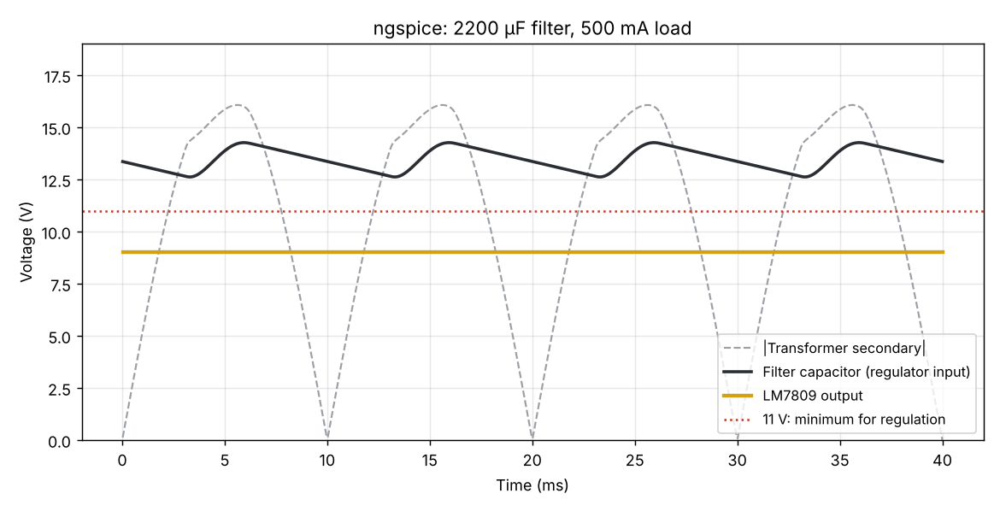

# Regulated DC Power Supply: 230 V AC to 9 V DC

A linear bench supply that turns 230 V, 50 Hz mains into a steady **9 V DC at up to 500 mA**, built from a step-down transformer, a full-wave bridge rectifier, a capacitor filter and an LM7809 regulator.

**Live demo:** https://mahendr99ar.github.io/regulated-power-supply-9v/ (change the filter capacitor, load and mains voltage and watch the ripple)


## Block diagram

```
230 V AC ─► Fuse ─► 230/12 V ─► Bridge rectifier ─► 2200 µF ─► LM7809 ─► 9 V DC
 50 Hz     500 mA   transformer   (4 × 1N4007)       filter     regulator   + LED indicator
```

| Stage | What it does |
| --- | --- |
| Fuse (500 mA, slow-blow) | Protects the transformer primary from short circuits |
| 230 V / 12 V, 1 A transformer | Steps mains down to a safe low voltage and isolates it |
| Bridge rectifier (4 × 1N4007) | Converts AC to pulsating DC (full-wave, 100 Hz ripple) |
| 2200 µF / 25 V capacitor | Smooths the pulses; sets the ripple |
| LM7809 + 0.33 µF in, 0.1 µF out | Holds the output at 9 V regardless of ripple and load |
| 1N4007 across LM7809 (output to input) | Protects the regulator if the input is shorted while output capacitors are charged |
| LED + 680 Ω | Power-on indicator |

## Design calculations

```bash
python3 design/psu_design.py
```

| Quantity | Formula | Value |
| --- | --- | --- |
| Secondary peak | 12 V × √2 | 16.97 V |
| Peak after bridge | 16.97 − 2 × 0.9 V | 15.17 V |
| Minimum regulator input | 9 V + 2 V dropout | 11.0 V |
| Ripple allowed | 15.17 − 11.0 | 4.17 V p-p |
| Minimum filter capacitor | C = I / (2 f ΔV) = 0.5 / (100 × 4.17) | 1199 µF |
| Capacitor used (50 % margin) | next standard value | **2200 µF / 25 V** |
| Expected ripple | 0.5 / (100 × 2200 µF) | 2.27 V p-p |
| Regulator dissipation at 0.5 A | (V_in,avg − 9 V) × I | ~2.5 W → heat sink needed |

## Simulation (ngspice)

`simulation/psu_9v.cir` models the transformer secondary, the 1N4007 bridge, the filter capacitor and a behavioural LM7809 with an 18 Ω (500 mA) load.

```bash
ngspice -b simulation/psu_9v.cir      # prints results, writes simulation/waveform.txt
python3 simulation/plot_waveform.py   # makes simulation/waveform.png
```



Results (`simulation/results.txt`), measured over the last 100 ms of a 400 ms run:

| Measurement | Value |
| --- | --- |
| Ripple at regulator input | 1.65 V p-p |
| Lowest regulator input | 12.6 V (above the 11 V needed) |
| Output voltage | 9.00 V, steady |
| Load current | 0.50 A |

The simulated ripple is lower than the hand estimate because the formula assumes the capacitor discharges for the whole half-cycle, which is a safe worst case.

### Known limit
At the full 500 mA load the regulator keeps its 2 V headroom only down to about **207 V mains**. Below that the capacitor dips under 11 V and ripple appears on the output. A 15 V transformer or a low-dropout regulator would fix this, at the cost of more heat or a costlier part.

## Bill of materials

| Part | Qty |
| --- | --- |
| 230 V / 12 V, 1 A step-down transformer | 1 |
| 500 mA slow-blow fuse + holder | 1 |
| 1N4007 diode | 5 |
| 2200 µF / 25 V electrolytic capacitor | 1 |
| LM7809 regulator + TO-220 heat sink | 1 |
| 0.33 µF and 0.1 µF ceramic capacitors | 1 each |
| Red LED + 680 Ω resistor | 1 |
| Mains cord, switch, enclosure, screw terminals | 1 set |

## Safety
- The primary side carries **230 V mains**. Insulate every mains joint, use a fused plug and an enclosure, and never touch the board while it is plugged in.
- Check the electrolytic capacitor's polarity before powering up.

## Repository layout

```
design/psu_design.py         ripple, capacitor and dissipation calculator
simulation/psu_9v.cir        ngspice model of the full supply
simulation/results.txt
simulation/plot_waveform.py  plots the ngspice waveforms
docs/                        project website (GitHub Pages)
```

## Contributors
- [Mahendra Meena](https://github.com/Mahendr99ar)
- [Kiran Meena](https://github.com/Kirann260)
